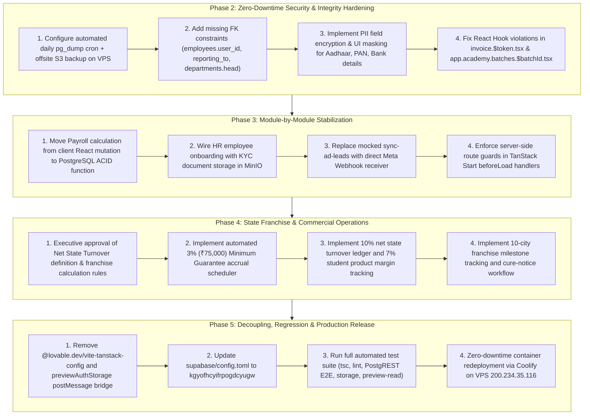

# FORENSIC AUDIT & TECHNICAL BASELINE REPORT
**Project:** Make Me Artist (MMA) Business Suite  
**Repository:** `https://github.com/eaglebaba13/mmabusinesssuite.git`  
**Workspace Path:** `E:\GitHub\MMA-Migration`  
**Supabase Production Project:** `kgyofhcyifrpogdcyugw` (`https://kgyofhcyifrpogdcyugw.supabase.co`)  
**Production Host / VPS:** `root@200.234.35.116` (Coolify v4.7.5 + Traefik v3.6)  
**Live Production URL:** `https://besuite.makemeartist.com`  
**Audit Timestamp:** 17 November 2026 (17:15 IST)  
**Audit Mode:** Strict Read-Only Forensic Discovery  
**Classification Standard:** `[VERIFIED]`, `[HISTORICAL]`, `[ASSUMPTION]`, `[DECISION REQUIRED]`

---

## EXECUTIVE SUMMARY

A comprehensive, non-destructive forensic audit was executed across the repository workspace, production database schemas, and live production VPS infrastructure. 

### Key High-Level Findings
1. **Repository Layout [VERIFIED]:** The root `E:\GitHub\MMA-Migration` acts as an umbrella migration workspace containing SQL backups, restore scripts, and the primary Git repository located at `E:\GitHub\MMA-Migration\mmabusinesssuite` (currently on branch `mma/npm10-lockfile-redeploy-20261004`, commit `61b7349`). An auxiliary git worktree is checked out at `E:\GitHub\MMA-Migration\mmabusinesssuite-reconciled` on branch `mma/reconciled-unix-main-20261005` (commit `0ac63f2`), while remote `origin/main` has advanced to commit `66b3027`.
2. **Production Deployment Topology [VERIFIED]:** The live application `https://besuite.makemeartist.com` is actively deployed on VPS `200.234.35.116` in Docker container `erishzzjey9qqopdtmb05ik9-20261103T091006`, built from commit `3362ca221d87dbf8bcfac5049dba782675aa86cf`. It is routed via Traefik reverse proxy behind Cloudflare CDN with TLS 1.3 encryption.
3. **Historical HR Audit Verified 100% [VERIFIED]:** Live Supabase database queries against `kgyofhcyifrpogdcyugw` confirmed that `employees`, `employee_attendance`, `leave_requests`, `payroll_runs`, `payroll_items`, and `departments` currently contain **EXACTLY 0 ROWS**. Plaintext identity and banking columns (`pan`, `aadhar`, `bank_account`, `bank_ifsc`) are defined in `employees`. No foreign key exists between `employees.user_id` and `auth.users(id)`, and no self-referencing foreign key exists on `employees.reporting_to`.
4. **Academy & Support Tables [VERIFIED]:** In addition to HR, all Academy tables (`students`, `courses`, `batches`, `enrollments`, `attendance`, `certificates`, `fee_payments`, `trainers`) and Support tables (`tickets`) currently contain **0 ROWS** in production.
5. **Live Commercial Data [VERIFIED]:** Active production tables with real records include `sales_orders` (480 rows), `sale_payments` (480 rows), `sales_order_items` (652 rows), `invoices` (477 rows), `roi_claims` (55 rows), `roi_payouts` (72 rows), `franchisees` (20 rows), `franchisee_credentials` (25 rows), `user_roles` (63 rows), and `products` (31 rows).
6. **Commercial Rules & Gaps [VERIFIED]:** 
   - The State Franchise Agreement model (₹25,00,000 fee, 3% / ₹75,000 monthly Minimum Guarantee, 10 city development target, 10% net state turnover share) is **completely unautomated** in backend services. `state_franchise_roi_ledger` has 0 rows and has no mutation/insert code in the repository.
   - The **7% student product sales margin** is completely absent from the database schema and code.
7. **Security & Backup Criticals [VERIFIED]:** 
   - No automated backup scripts or crontabs are configured on the VPS (`/data/coolify/backups` is empty).
   - In `src/routes/invoice.$token.tsx`, a React Hook violation (conditional `useState` after early return) introduces runtime render risks.
   - Lovable platform artifacts remain embedded in build tooling (`@lovable.dev/vite-tanstack-config`), storage auth brokers (`previewAuthStorage.ts`), webhook headers (`x-lovable-signature`), and metadata.

---

## 1. REPOSITORY & BUILD BASELINE (`E:\GitHub\MMA-Migration`)

### 1.1 Git Status & Configuration
- **Root Directory:** `E:\GitHub\MMA-Migration` is not a git repository itself; it serves as a workspace housing database dumps, migration scripts, and Git worktrees.
- **Primary Git Repository Path:** `E:\GitHub\MMA-Migration\mmabusinesssuite`
- **Active Branch:** `mma/npm10-lockfile-redeploy-20261004`
- **Working Tree State:** Clean (`nothing to commit, working tree clean`)
- **Remote Configuration:**
  ```text
  origin  https://github.com/eaglebaba13/mmabusinesssuite.git (fetch)
  origin  https://github.com/eaglebaba13/mmabusinesssuite.git (push)
  ```
- **Git Worktree List:**
  - `E:/GitHub/MMA-Migration/mmabusinesssuite` -> commit `61b7349` (`mma/npm10-lockfile-redeploy-20261004`)
  - `E:/GitHub/MMA-Migration/mmabusinesssuite-reconciled` -> commit `0ac63f2` (`mma/reconciled-unix-main-20261005`)
- **Commit History Comparison [VERIFIED]:**
  - Remote `origin/main`: Tip is at commit `66b3027` (`Lovable update`), which is only 1 line ahead of `0ac63f2` (updated `@lovable.dev/vite-tanstack-config` to `2.25.3`).
  - Worktree `mmabusinesssuite`: Head is at commit `61b7349` (`Route MinIO S3 transport over a Unix socket relay`).
  - Worktree `mmabusinesssuite-reconciled`: Head is at commit `0ac63f2` (`Fix Sales post-login navigation loop`), with uncommitted local security migrations from October 2026 (`20261017` to `20261020`).
  - Production Deployed Image on VPS: Tagged with commit `3362ca221d87dbf8bcfac5049dba782675aa86cf` (`SECURITY: Reconcile production source for B1-B5 cutover`).

### 1.2 Package & Build Configuration
- **Application Framework:** TanStack Start (`@tanstack/react-start` `^1.167.14`), TanStack Router (`^1.168.0`), Vite (`^7.3.1`), Nitro (`3.0.260603-beta`).
- **Language / Runtime:** TypeScript (`^5.8.3`), React (`^19.2.0`), Node.js (v20+ / v22 on VPS).
- **Styling & UI:** Tailwind CSS (`^4.2.1`), Radix UI primitives, Lucide React (`^0.575.0`).
- **Database Client:** Supabase JS SDK (`@supabase/supabase-js` `^2.104.0`).
- **File & PDF Processing:** `@aws-sdk/client-s3` (`3.1146.0`), `jspdf` (`^4.2.1`), `docx` (`^9.7.1`), `xlsx` (`0.18.5`).
- **Build Targets:** Self-hosted production server uses Nitro's `node-server` preset configured via `@lovable.dev/vite-tanstack-config`.

### 1.3 Compiler & Static Quality Checks [VERIFIED]
- **TypeScript Typecheck (`npm run typecheck` / `tsc --noEmit`):**
  - **Result: PASS (Exit code 0).** No TypeScript compilation errors exist in `mmabusinesssuite`.
- **ESLint Quality Check (`npm run lint` / `eslint .`):**
  - **Whitespace Issues:** 45,909 errors caused by Windows CRLF line-ending mismatches with Prettier rules (`Delete ␍ prettier/prettier`).
  - **Critical React Hook Errors [VERIFIED]:**
    1. `src/routes/invoice.$token.tsx:63:41`:
       - `React Hook "React.useState" is called conditionally. React Hooks must be called in the exact same order in every component render. Did you accidentally call a React Hook after an early return? react-hooks/rules-of-hooks`
       - **Cause:** Line 61 contains an early return `if (!o) return ...;` immediately followed by line 63 `const [previewOpen, setPreviewOpen] = React.useState(false);`.
    2. `src/routes/app.academy.batches.$batchId.tsx:23:20`:
       - `React Hook "useRouter" is called in function "errorComponent" that is neither a React function component nor a custom React Hook function. react-hooks/rules-of-hooks`
       - **Cause:** `errorComponent` is defined in lowercase rather than PascalCase.

### 1.4 Environment Variables & Secrets Audit [VERIFIED]
In compliance with Critical Safety Rule #2, actual secret values have not been logged or extracted. Variable names identified across workspace configurations:
- **Local Workspace (`mmabusinesssuite/.env`):**
  - `SUPABASE_PROJECT_ID`
  - `SUPABASE_URL`
  - `SUPABASE_PUBLISHABLE_KEY` (placeholder/empty locally)
  - `VITE_SUPABASE_PROJECT_ID`
  - `VITE_SUPABASE_URL`
  - `VITE_SUPABASE_PUBLISHABLE_KEY`
- **Template (`.env.example`):**
  - `VITE_SUPABASE_PROJECT_ID`
  - `VITE_SUPABASE_URL`
  - `VITE_SUPABASE_PUBLISHABLE_KEY`
  - `SUPABASE_URL`
  - `SUPABASE_PUBLISHABLE_KEY`
  - `SUPABASE_SERVICE_ROLE_KEY`
  - `MINIO_ENDPOINT`
  - `MINIO_REGION`
  - `MINIO_ACCESS_KEY`
  - `MINIO_SECRET_KEY`
- **Production Container Environment (`erishzzjey9qqopdtmb05ik9-20261103T091006` on VPS):**
  - `SUPABASE_PUBLISHABLE_KEY`
  - `SUPABASE_SERVICE_ROLE_KEY`
  - `SUPABASE_URL` (`https://kgyofhcyifrpogdcyugw.supabase.co`)
  - `SUPABASE_PROJECT_ID` (`kgyofhcyifrpogdcyugw`)
  - `VITE_SUPABASE_URL` (`https://kgyofhcyifrpogdcyugw.supabase.co`)
  - `VITE_SUPABASE_PUBLISHABLE_KEY`
  - `MINIO_ACCESS_KEY`
  - `MINIO_ALLOWED_ACCESS_KEY`
  - `MINIO_ENDPOINT`
  - `MINIO_REGION`
  - `MINIO_SECRET_KEY`
  - `MINIO_SOCKET_PATH`
  - `WEBINAR_CRON_SECRET`
  - `COOLIFY_FQDN` (`besuite.makemeartist.com`)
  - `COOLIFY_BRANCH` (`main`)
  - `SOURCE_COMMIT` (`3362ca221d87dbf8bcfac5049dba782675aa86cf`)
  - `PORT` (`3000`)

### 1.5 Legacy Platform & Project References [VERIFIED]
- **Legacy Supabase Project Reference (`tdcyyaoeatwwgriokwdc`):**
  - Found in `mmabusinesssuite/supabase/config.toml` (`project_id = "tdcyyaoeatwwgriokwdc"`).
  - Note: In worktree `mmabusinesssuite-reconciled`, this was manually updated to `kgyofhcyifrpogdcyugw`, but the fix has not been merged into `mmabusinesssuite` main.
- **Lovable Dependencies & Artifacts:**
  - `package.json` contains `@lovable.dev/vite-tanstack-config` (`2.23.1` in worktree, `2.25.3` on origin/main).
  - `src/integrations/supabase/previewAuthStorage.ts`: Configures `brokeredPreviewStorage()` which posts auth tokens via `window.parent.postMessage` to `lovable.dev`, `lovableproject.com`, and `gptengineer.app`.
  - `src/routes/__root.tsx`: Contains hardcoded OpenGraph and Twitter image URLs pointing to `*.lovable.app` assets on Cloudflare R2 CDN.
  - `src/routes/api/public/social-lead-hook.ts` & `src/routes/app.settings.social.tsx`: Relies on HTTP header `x-lovable-signature`.
  - Migration `20260422150415_edc93160-b828-4f04-9374-f9b628ffc509.sql`: Contains a hardcoded URL `https://mmabusinesssuite.lovable.app/api/public/webinar-reminders`.

---

## 2. ARCHITECTURE & ROUTE INVENTORY

### 2.1 Directory Structure (`src/`)
```text
src/
├── assets/                 # Brand logos and iconography
├── components/
│   ├── app/                # Application widgets, KPI cards, sidebar, rosters, modals
│   │   └── franchise/      # Agreement builder, ROI calculator, product editors
│   ├── brand/              # Approved MakeMeArtist logos and visual identity
│   ├── marketing/          # Public marketing components
│   └── ui/                 # Reusable Radix UI design system components
├── hooks/
│   ├── use-mobile.tsx      # Viewport detection
│   ├── use-persisted-state.ts # LocalStorage state persistence
│   └── use-role-guard.ts   # Role redirection hook
├── integrations/
│   └── supabase/
│       ├── auth-middleware.ts      # Server-side auth verification for RPC
│       ├── client.server.ts        # Service-role client for trusted server RPC
│       ├── client.ts               # Browser client proxy (with brokered preview storage)
│       ├── previewAuthStorage.ts   # Lovable preview iframe postMessage bridge
│       └── types.ts                # TypeScript schema generated from PostgreSQL
├── lib/
│   ├── docgen/             # PDF and Word document generators (agreements, termination)
│   ├── rpc/                # TanStack Start server functions (impersonation, catalog, invoices)
│   ├── auth-context.tsx    # React AuthProvider, session listener, role caching
│   ├── export.ts           # CSV and basic PDF data export utilities
│   ├── format.ts           # Indian Rupee (INR) and date formatters
│   ├── invoice-pdf.ts      # Tax invoice PDF generator with GST breakdown
│   ├── mode-context.tsx    # Testing / Demo vs Production mode switch
│   ├── storage-policy.ts   # MinIO bucket access control rules
│   └── storage.server.ts   # MinIO S3 SDK client initialization
└── routes/
    ├── __root.tsx          # Root shell, HTML head, query provider, auth provider
    ├── index.tsx           # Public landing page
    ├── login.tsx           # Authentication screen
    ├── pricing.tsx         # Public franchise pricing table
    ├── signup.tsx          # Account registration
    ├── invoice.$token.tsx  # Public invoice view
    ├── webinar.$slug.tsx   # Public webinar registration page
    ├── api/                # Server-rendered API routes
    │   ├── storage.ts      # MinIO authorized file download endpoint
    │   ├── storage-export.ts # File export endpoint
    │   └── public/
    │       ├── social-lead-hook.ts      # External lead ingestion webhook
    │       ├── webinar-register-hook.ts # Webinar signups
    │       └── webinar-reminders.ts     # Webinar reminder trigger
    └── app/                # Authenticated Application Shell
        ├── index.tsx
        ├── dashboard.tsx   # Master Admin Executive Dashboard
        ├── academy/        # Student admissions, courses, batches, certificates
        ├── billing/        # Invoices and billing rules
        ├── finance/        # Revenue, expenses, categories, payouts
        ├── franchise-products/ # Franchise catalog configuration
        ├── franchisees/    # Franchisee roster, details, and documents
        ├── hr/             # Employees, attendance, leave, payroll
        ├── inventory/      # Products, stock, purchase orders, warehouses
        ├── leads/          # CRM pipeline, kanban, lead routing
        ├── my-franchise.tsx# Franchisee self-service portal
        ├── my-state.tsx    # State Franchise partner portal
        ├── payouts/        # City and State franchise ROI/incentive payouts
        ├── pos/            # Point-of-Sale terminal and retail orders
        ├── reports/        # Cross-functional MIS reporting
        ├── settings/       # Organization, team, social, sidebar settings
        ├── state-franchises/ # State franchise partner management
        └── webinars/       # Webinar management & attendee analytics
```

### 2.2 Authentication & Role-Based Routing
- **Session Lifecycle:** 
  - Managed by Supabase GoTrue via `src/lib/auth-context.tsx`.
  - On auth state change, the active user's roles are fetched client-side from `public.user_roles`:
    ```typescript
    const { data } = await supabase.from("user_roles").select("role").eq("user_id", userId);
    ```
- **Supported Role Hierarchy:**
  `super_admin`, `founder`, `franchisee`, `sales`, `accounts`, `inventory`, `academy_admin`, `webinar`, `hr`, `white_label`, `trainer`, `support`, `package_sales`, `nail_emporium`, `state_franchisee`.
- **Route Guard Mechanism [VERIFIED]:**
  - Route gating is implemented **purely client-side** inside a `React.useEffect` in `src/routes/app.tsx` (lines 35-66).
  - Pure franchisees (`hasRole("franchisee") && !isAdmin`) are redirected to `/app/my-franchise`.
  - State franchisees (`hasRole("state_franchisee") && !isAdmin`) are restricted to `/app/my-state`, `/app/my-franchise`, `/app/inventory`, and `/app/pos`.
  - `ADMIN_ONLY` list: `/app/audit-logs`, `/app/impersonation-sessions`, `/app/state-franchises`, `/app/settings`, `/app/dashboard`.
  - `ACCOUNTS_OR_ADMIN` list: `/app/billing`, `/app/finance`, `/app/payouts`, `/app/accounts`, `/app/reports`, `/app/dashboards`.
  - **Security Gap [VERIFIED]:** Routes such as `/app/hr`, `/app/hr/employees`, `/app/hr/payroll`, and `/app/leads` are NOT listed in `ADMIN_ONLY` or role-restricted in `app.tsx`. Non-admin roles (e.g. `sales`, `inventory`, `trainer`) are not blocked client-side from navigating directly to `/app/hr`.

---

## 3. SUPABASE & DATABASE FORENSIC AUDIT (`kgyofhcyifrpogdcyugw`)

### 3.1 Database Inventory & Live Row Counts [VERIFIED]
Below is the complete inventory of all 81 discovered public tables, grouped by domain, with live row counts queried directly from Supabase project `kgyofhcyifrpogdcyugw`:

| Domain | Table Name | Live Row Count | Primary Key | Key Foreign Keys |
| :--- | :--- | :--- | :--- | :--- |
| **HR & Payroll** | `departments` | **0** | `id` | None (missing FK on `head_employee_id`) |
| | `employees` | **0** | `id` | `department_id` -> `departments(id)` (missing FK on `user_id`, `reporting_to`) |
| | `employee_attendance` | **0** | `id` | `employee_id` -> `employees(id)` |
| | `leave_requests` | **0** | `id` | `employee_id` -> `employees(id)` |
| | `payroll_runs` | **0** | `id` | None |
| | `payroll_items` | **0** | `id` | `payroll_run_id` -> `payroll_runs(id)`, `employee_id` -> `employees(id)` |
| **Academy** | `students` | **0** | `id` | None |
| | `courses` | **0** | `id` | None |
| | `batches` | **0** | `id` | `course_id` -> `courses(id)`, `trainer_id` -> `trainers(id)` |
| | `enrollments` | **0** | `id` | `batch_id` -> `batches(id)`, `student_id` -> `students(id)` |
| | `attendance` | **0** | `id` | `enrollment_id` -> `enrollments(id)` |
| | `certificates` | **0** | `id` | `enrollment_id` -> `enrollments(id)` |
| | `fee_payments` | **0** | `id` | `enrollment_id` -> `enrollments(id)` |
| | `trainers` | **0** | `id` | None |
| **CRM & Leads** | `leads` | **1** | `id` | `territory_id` -> `territories(id)`, `franchise_product_id` -> `franchise_products(id)` |
| | `lead_activities` | **21** | `id` | `lead_id` -> `leads(id)`, `user_id` -> `auth.users(id)` |
| | `social_lead_events` | **22** | `id` | `lead_id` -> `leads(id)`, `assigned_franchisee_id` -> `franchisees(id)` |
| | `lead_routing_rules` | **0** | `id` | `assign_territory_id` -> `territories(id)`, `assign_franchisee_id` -> `franchisees(id)` |
| | `social_integrations` | **0** | `id` | `franchisee_id` -> `franchisees(id)` |
| | `ad_campaigns` | **0** | `id` | `franchisee_id` -> `franchisees(id)` |
| **Franchise ERP** | `franchisees` | **20** | `id` | `territory_id` -> `territories(id)`, `warehouse_id` -> `warehouses(id)` |
| | `franchisee_credentials`| **25** | `id` | `franchisee_id` -> `franchisees(id)` |
| | `franchisee_documents` | **8** | `id` | `franchisee_id` -> `franchisees(id)`, `uploaded_by` -> `auth.users(id)` |
| | `franchisee_targets` | **0** | `id` | `franchisee_id` -> `franchisees(id)` |
| | `franchise_agreements` | **0** | `id` | `franchisee_id` -> `franchisees(id)`, `product_id` -> `franchise_products(id)` |
| | `agreement_audit_log` | **91** | `id` | `franchisee_id` -> `franchisees(id)`, `changed_by` -> `auth.users(id)` |
| | `state_franchises` | **4** | `id` | None |
| | `state_franchise_credentials` | **0** | `id` | `state_franchise_id` -> `state_franchises(id)` |
| | `state_franchise_roi_ledger` | **0** | `id` | `state_franchise_id` -> `state_franchises(id)` |
| | `state_franchise_incentive_ledger` | **0** | `id` | `state_franchise_id` -> `state_franchises(id)` |
| | `state_franchise_targets`| **0** | `id` | `state_franchise_id` -> `state_franchises(id)` |
| | `territories` | **12** | `id` | `state_franchise_id` -> `state_franchises(id)` |
| | `roi_claims` | **55** | `id` | `franchisee_id` -> `franchisees(id)`, `payout_id` -> `roi_payouts(id)` |
| | `roi_claim_versions` | **52** | `id` | `claim_id` -> `roi_claims(id)` |
| | `roi_payouts` | **72** | `id` | `franchisee_id` -> `franchisees(id)` |
| | `org_roi_settings` | **1** | `id` | None |
| **Sales & POS** | `sales_orders` | **480** | `id` | `company_id` -> `companies(id)`, `franchisee_id` -> `franchisees(id)`, `warehouse_id` -> `warehouses(id)` |
| | `sale_payments` | **480** | `id` | `order_id` -> `sales_orders(id)` |
| | `sales_order_items` | **652** | `id` | `order_id` -> `sales_orders(id)`, `product_id` -> `products(id)` |
| | `invoices` | **477** | `id` | `company_id` -> `companies(id)`, `franchisee_id` -> `franchisees(id)`, `state_franchise_id` -> `state_franchises(id)` |
| | `invoice_items` | **0** | `id` | `invoice_id` -> `invoices(id)`, `product_id` -> `products(id)` |
| | `invoice_numbering_rules`| **28** | `id` | `company_id` -> `companies(id)` |
| | `invoice_share_tokens` | **0** | `token` | `order_id` -> `sales_orders(id)` |
| **Inventory & Goods**| `products` | **31** | `id` | `category_id` -> `product_categories(id)` |
| | `product_categories` | **11** | `id` | `parent_id` -> `product_categories(id)` |
| | `stock_levels` | **6** | `id` | `product_id` -> `products(id)`, `warehouse_id` -> `warehouses(id)` |
| | `stock_movements` | **47** | `id` | `product_id` -> `products(id)`, `source_warehouse_id` -> `warehouses(id)` |
| | `warehouses` | **2** | `id` | None |
| | `suppliers` | **1** | `id` | None |
| | `purchase_orders` | **2** | `id` | `supplier_id` -> `suppliers(id)`, `warehouse_id` -> `warehouses(id)` |
| | `purchase_order_items`| **4** | `id` | `po_id` -> `purchase_orders(id)`, `product_id` -> `products(id)` |
| **Corporate & Auth** | `companies` | **4** | `id` | `parent_company_id` -> `companies(id)` |
| | `salon_branches` | **4** | `id` | `company_id` -> `companies(id)`, `territory_id` -> `territories(id)` |
| | `profiles` | **24** | `id` | `id` -> `auth.users(id)` |
| | `user_roles` | **63** | `id` | `user_id` -> `auth.users(id)` |
| | `user_entity_access` | **0** | `id` | None |
| | `org_settings` | **1** | `id` | None |
| **Audit & Security** | `audit_logs` | **41** | `id` | `user_id` -> `auth.users(id)` |
| | `impersonation_sessions`| **207**| `id` | None |
| | `impersonation_audit` | **545**| `id` | `session_id` -> `impersonation_sessions(id)` |
| | `official_documents` | **18** | `id` | `employee_id` -> `employees(id)`, `franchisee_id` -> `franchisees(id)` |
| | `official_document_versions`| **31** | `id` | `document_id` -> `official_documents(id)` |
| **Webinars & Support**| `webinars` | **0** | `id` | None |
| | `webinar_registrations`| **0** | `id` | `webinar_id` -> `webinars(id)` |
| | `tickets` | **0** | `id` | `created_by` -> `auth.users(id)`, `assigned_to` -> `auth.users(id)` |
| | `notifications` | **0** | `id` | `user_id` -> `auth.users(id)` |

---

### 3.2 Mermaid Entity-Relationship Diagram (ERD)

```mermaid
erDiagram
    COMPANIES ||--o{ COMPANIES : "parent_company_id"
    COMPANIES ||--o{ INVOICES : "company_id / bill_to_company_id"
    COMPANIES ||--o{ SALES_ORDERS : "company_id"
    COMPANIES ||--o{ SALON_BRANCHES : "company_id"

    STATE_FRANCHISES ||--o{ TERRITORIES : "state_franchise_id"
    STATE_FRANCHISES ||--o{ INVOICES : "state_franchise_id"
    STATE_FRANCHISES ||--o{ STATE_FRANCHISE_ROI_LEDGER : "state_franchise_id"
    STATE_FRANCHISES ||--o{ STATE_FRANCHISE_INCENTIVE_LEDGER : "state_franchise_id"
    STATE_FRANCHISES ||--o{ STATE_FRANCHISE_TARGETS : "state_franchise_id"

    TERRITORIES ||--o{ FRANCHISEES : "territory_id"
    TERRITORIES ||--o{ LEADS : "territory_id"
    TERRITORIES ||--o{ SALON_BRANCHES : "territory_id"

    FRANCHISE_REVENUE_MODELS ||--o{ FRANCHISE_PRODUCTS : "revenue_model_id"
    FRANCHISE_REVENUE_MODELS ||--o{ FRANCHISE_REVENUE_MODEL_SPLITS : "model_id"
    FRANCHISE_PRODUCTS ||--o{ FRANCHISEES : "franchise_product_id"
    FRANCHISE_PRODUCTS ||--o{ LEADS : "franchise_product_id"
    FRANCHISE_PRODUCTS ||--o{ FRANCHISE_AGREEMENTS : "product_id"

    FRANCHISEES ||--o{ SALES_ORDERS : "franchisee_id"
    FRANCHISEES ||--o{ INVOICES : "franchisee_id"
    FRANCHISEES ||--o{ ROI_CLAIMS : "franchisee_id"
    FRANCHISEES ||--o{ ROI_PAYOUTS : "franchisee_id"
    FRANCHISEES ||--o{ FRANCHISEE_CREDENTIALS : "franchisee_id"
    FRANCHISEES ||--o{ FRANCHISEE_DOCUMENTS : "franchisee_id"
    FRANCHISEES ||--o{ AGREEMENT_AUDIT_LOG : "franchisee_id"

    ROI_PAYOUTS ||--o{ ROI_CLAIMS : "payout_id"
    ROI_CLAIMS ||--o{ ROI_CLAIM_VERSIONS : "claim_id"

    SALES_ORDERS ||--o{ SALES_ORDER_ITEMS : "order_id"
    SALES_ORDERS ||--o{ SALE_PAYMENTS : "order_id"
    SALES_ORDERS ||--o{ INVOICE_SHARE_TOKENS : "order_id"
    INVOICES ||--o{ INVOICE_ITEMS : "invoice_id"

    PRODUCTS ||--o{ SALES_ORDER_ITEMS : "product_id"
    PRODUCTS ||--o{ INVOICE_ITEMS : "product_id"
    PRODUCTS ||--o{ STOCK_LEVELS : "product_id"
    PRODUCTS ||--o{ STOCK_MOVEMENTS : "product_id"
    PRODUCT_CATEGORIES ||--o{ PRODUCTS : "category_id"
    PRODUCT_CATEGORIES ||--o{ PRODUCT_CATEGORIES : "parent_id"

    WAREHOUSES ||--o{ SALES_ORDERS : "warehouse_id"
    WAREHOUSES ||--o{ STOCK_LEVELS : "warehouse_id"
    WAREHOUSES ||--o{ STOCK_MOVEMENTS : "source_warehouse_id / destination_warehouse_id"
    WAREHOUSES ||--o{ PURCHASE_ORDERS : "warehouse_id"

    LEADS ||--o{ LEAD_ACTIVITIES : "lead_id"
    LEADS ||--o{ SOCIAL_LEAD_EVENTS : "lead_id"

    DEPARTMENTS ||--o{ EMPLOYEES : "department_id"
    EMPLOYEES ||--o{ EMPLOYEE_ATTENDANCE : "employee_id"
    EMPLOYEES ||--o{ LEAVE_REQUESTS : "employee_id"
    EMPLOYEES ||--o{ PAYROLL_ITEMS : "employee_id"
    PAYROLL_RUNS ||--o{ PAYROLL_ITEMS : "payroll_run_id"

    COURSES ||--o{ BATCHES : "course_id"
    TRAINERS ||--o{ BATCHES : "trainer_id"
    BATCHES ||--o{ ENROLLMENTS : "batch_id"
    STUDENTS ||--o{ ENROLLMENTS : "student_id"
    ENROLLMENTS ||--o{ ATTENDANCE : "enrollment_id"
    ENROLLMENTS ||--o{ CERTIFICATES : "enrollment_id"
    ENROLLMENTS ||--o{ FEE_PAYMENTS : "enrollment_id"

    WEBINARS ||--o{ WEBINAR_REGISTRATIONS : "webinar_id"
    IMPERSONATION_SESSIONS ||--o{ IMPERSONATION_AUDIT : "session_id"
    OFFICIAL_DOCUMENTS ||--o{ OFFICIAL_DOCUMENT_VERSIONS : "document_id"
```



---

### 3.3 Explicit Verification of Historical Audit Findings [VERIFIED]

| Item | Question / Finding | Historical Status | Current Live Audit Status | Evidence / Verification Method |
| :--- | :--- | :--- | :--- | :--- |
| **a** | Do `employees`, `employee_attendance`, `leave_requests`, `payroll_runs`, `payroll_items`, and `departments` exist and what are their row counts? | Reported as 0 rows | **[VERIFIED] 0 ROWS** across all 6 tables | Exact `HEAD` query against Supabase live REST API with `Prefer: count=exact`. |
| **b** | Are PAN, Aadhaar, bank account, and IFSC stored as plaintext columns in `employees`? | Plaintext columns flagged | **[VERIFIED] TRUE (CRITICAL)** | Schema columns in `public.employees`: `pan text`, `aadhar text`, `bank_account text`, `bank_ifsc text`, `bank_name text`. No database-level encryption or pgcrypto vault applied. |
| **c** | Is there a foreign key from `employees.user_id` to `auth.users`? | Missing FK flagged | **[VERIFIED] MISSING FK** | Inspected `public-fk-details.txt` and `public-postdata.sql`. Column `user_id uuid` has an index (`idx_hr_employees_user`) but no foreign key constraint to `auth.users(id)`. |
| **d** | Is there a self-referencing foreign key on `employees` for the reporting manager? | Missing FK flagged | **[VERIFIED] MISSING FK** | Column `reporting_to uuid` exists with NO foreign key constraint referencing `employees(id)`. |

---

### 3.4 Row-Level Security (RLS) & Policy Audit [VERIFIED]
- **RLS Enablement:** All **81 public base tables** have `ENABLE ROW LEVEL SECURITY` turned ON.
- **Total Policies:** Exactly **210 RLS policies** are configured.
- **Permissive `USING (true)` Policies Flagged:**
  1. `public.franchise_product_media`: Policy `product_media_read_auth` allows ANY authenticated user to read all media records (`USING (true)`).
  2. `public.franchise_revenue_models`: Policy `revenue_models_read_auth` allows ANY authenticated user to read revenue model formulas (`USING (true)`).
  3. `public.franchise_product_types`: Policy `types_read_authenticated` allows ANY authenticated user to read all product types (`USING (true)`).
  4. `public.batches`: Policy `batches read all auth` allows ANY authenticated user to inspect all academy batches (`USING ((auth.uid() IS NOT NULL))`).
  5. `public.webinars`: Policy `webinars public read published` allows unauthenticated (`anon`) users to read published webinars.
  6. `public.webinar_registrations`: Policy `wr public insert` allows `anon` to insert registrations.
- **Unspecified `TO` Role (Defaults to `TO public`):** 130 policies omit the `TO` clause. While most safely guard rows with `auth.uid() IS NOT NULL` or `is_admin(auth.uid())`, Postgres evaluates these against the `anon` role on every unauthenticated request, consuming evaluation overhead.

---

## 4. MODULE-BY-MODULE IMPLEMENTATION MATRIX

| Module Domain | Exact File Paths | DB Tables & Row Counts | UI Completion % | Backend Wiring Status | Broken / Mocked / Missing Flows |
| :--- | :--- | :--- | :---: | :--- | :--- |
| **HR & Employee Onboarding** | `src/routes/app.hr.tsx`<br>`src/routes/app.hr.employees.tsx`<br>`src/routes/app.hr.index.tsx` | `employees` (0)<br>`departments` (0)<br>`official_documents` (18) | 40% | Direct client queries (`supabase.from("employees").select("*")`) | **[VERIFIED] 0 rows in DB.** Form in `app.hr.employees.tsx` lacks fields for PAN, Aadhaar, bank details, and zones. No document upload or KYC flow. No manager hierarchy selector. |
| **Attendance & Leave Management** | `src/routes/app.hr.attendance.tsx`<br>`src/routes/app.hr.leave.tsx` | `employee_attendance` (0)<br>`leave_requests` (0) | 40% | Direct client queries | **[VERIFIED] 0 rows in DB.** Attendance is a manual web checklist. **Zero employee GPS/device/mobile tracking code exists.** Leave approvals lack manager hierarchy checks or entitlement balances. |
| **Payroll Runs & Payslip Generation** | `src/routes/app.hr.payroll.tsx` | `payroll_runs` (0)<br>`payroll_items` (0) | 45% | Client-side calculations in React mutation | **[VERIFIED] 0 rows in DB.** Gross pay, PF (12%), and tax (5%) are hardcoded in a client-side React mutation (`generateRun`) rather than an ACID database transaction. No payslip PDF download wired. |
| **CRM & Meta Lead Integration** | `src/routes/api/public/social-lead-hook.ts`<br>`src/routes/app.leads.tsx`<br>`src/routes/app.settings.social.tsx`<br>`supabase/functions/sync-ad-leads/index.ts` | `leads` (1)<br>`lead_activities` (21)<br>`social_lead_events` (22)<br>`lead_routing_rules` (0)<br>`social_integrations` (0) | 65% | Webhook endpoint functional for Zapier / HMAC format. Edge function is 100% mocked. | **[VERIFIED] Edge function `sync-ad-leads` is a stub** (`syncMeta` returns `{ leads: 0, campaigns: 0 }`). Webhook requires third-party middleware (Zapier/Make); no direct Meta Graph Webhook challenge/signature handler (`X-Hub-Signature-256`). |
| **Academy / Student Admissions** | `src/routes/app.academy.tsx`<br>`src/routes/app.academy.students.tsx`<br>`src/routes/app.academy.courses.tsx`<br>`src/routes/app.academy.batches.tsx`<br>`src/routes/app.academy.fees.tsx`<br>`src/routes/app.academy.certificates.tsx` | `students` (0)<br>`courses` (0)<br>`batches` (0)<br>`enrollments` (0)<br>`attendance` (0)<br>`certificates` (0)<br>`fee_payments` (0)<br>`trainers` (0) | 75% (UI complete) | Direct client queries | **[VERIFIED] 0 rows in DB.** Complete UI exists, but no student admissions have occurred. No public admission portal or online payment gateway integration for course fees. |
| **Product Sales & 7% Margin** | `src/routes/app.pos.tsx`<br>`src/routes/app.pos.orders.tsx`<br>`src/lib/invoice-pdf.ts`<br>`src/lib/docgen/builders.ts` | `sales_orders` (480)<br>`sale_payments` (480)<br>`sales_order_items` (652)<br>`invoices` (477)<br>`products` (31) | 85% (POS is operational) | Active RPC and Supabase queries | **[VERIFIED] 7% Student Margin is completely missing.** No schema columns, ledgers, or calculation triggers exist for tracking student product margins. Only a generic "Academy Trading Margin" label exists in docgen. |
| **State & City Franchise ERP** | `src/routes/app.state-franchises.tsx`<br>`src/routes/app.state-franchises.$stateFranchiseId.tsx`<br>`src/routes/app.my-state.tsx`<br>`src/routes/app.payouts.state.tsx` | `state_franchises` (4)<br>`territories` (12)<br>`state_franchise_roi_ledger` (0)<br>`state_franchise_incentive_ledger` (0)<br>`state_franchise_targets` (0) | 50% | Rosters wired; financial calculation engine absent | **[VERIFIED] Payout ledger is completely unpopulated.** The ₹25,00,000 fee is defaulted to ₹10,00,000 in UI. No background worker or SQL function calculates the 3% (₹75,00,00) Minimum Guarantee or the 10% net state turnover share. Termination is only a static letter generator. |
| **MIS, Compliance & Admin Support** | `src/routes/app.reports.tsx`<br>`src/routes/app.support.tsx`<br>`src/routes/app.audit-logs.tsx`<br>`src/routes/app.impersonation-sessions.tsx` | `audit_logs` (41)<br>`impersonation_sessions` (207)<br>`impersonation_audit` (545)<br>`tickets` (0) | 70% | Functional for audit and reporting | Support tickets table has 0 rows. Impersonation session management and audit trails are fully functional and actively logged. |

---

## 5. SECURITY VULNERABILITIES & PRIVACY RISKS

### Ranked Vulnerabilities Matrix

| Rank | Severity | Vulnerability Description | Exact File Path & Lines | Impact & Remediation |
| :---: | :---: | :--- | :--- | :--- |
| **V-01** | **CRITICAL** | **Plaintext Employee PII (Aadhaar, PAN, Bank Details)** | `public.employees` schema<br>`src/routes/app.hr.employees.tsx:74-78` | **Impact:** `select("*")` fetches unencrypted Aadhaar, PAN, bank account, and IFSC numbers to browser client state.<br>**Remediation:** Implement column-level encryption (pgcrypto / Supabase Vault) and project only masked strings (`XXXX-XXXX-1234`) to the UI. |
| **V-02** | **CRITICAL** | **No Automated Backup Infrastructure on VPS Host** | `/data/coolify/backups`<br>Host: `root@200.234.35.116` | **Impact:** `/data/coolify/backups` is completely empty and root crontab has no entries. Any VPS hardware failure or container corruption results in total data loss.<br>**Remediation:** Deploy daily automated `pg_dump` cron jobs with remote encrypted S3 offsite backups. |
| **V-03** | **HIGH** | **Client-Side-Only Route Protection** | `src/routes/app.tsx:35-66` | **Impact:** Route guards are executed purely in `React.useEffect` after the client bundle mounts. Non-admin users can access sensitive endpoints (`/app/hr`) if RLS does not explicitly block every read.<br>**Remediation:** Enforce server-side route guards in TanStack Start `beforeLoad` handlers. |
| **V-04** | **HIGH** | **Missing Foreign Key Integrity Constraints** | `public-fk-details.txt`<br>`public.employees` | **Impact:** `employees.user_id` has no FK to `auth.users(id)`; `employees.reporting_to` has no FK to `employees(id)`. Ghost employees and corrupted hierarchy chains can be created.<br>**Remediation:** Add `ALTER TABLE public.employees ADD CONSTRAINT ... FOREIGN KEY ...` migrations. |
| **V-05** | **HIGH** | **Client-Side Financial Calculations for Payroll** | `src/routes/app.hr.payroll.tsx:113-130` | **Impact:** Salary, PF deductions, and tax withholding are computed in browser JavaScript and inserted via unbatched client mutations, risking partial insertions on network drops.<br>**Remediation:** Migrate payroll calculation to a PostgreSQL transactional function (`process_payroll_run`). |
| **V-06** | **HIGH** | **Conditional React Hook Invocation (Runtime Crash Risk)** | `src/routes/invoice.$token.tsx:61-63` | **Impact:** An early `return` precedes `React.useState`, violating React's Rules of Hooks and causing runtime exceptions during state hydration.<br>**Remediation:** Move all hook declarations above any conditional early returns. |
| **V-07** | **MEDIUM** | **Lovable Preview PostMessage Auth Broker** | `src/integrations/supabase/previewAuthStorage.ts` | **Impact:** Application attempts `window.parent.postMessage` session sync when embedded in Lovable/GPT-Engineer domains.<br>**Remediation:** Strip out preview broker and standardize on standard `localStorage` / cookie session storage. |
| **V-08** | **MEDIUM** | **Mocked Ad Leads Synchronization** | `supabase/functions/sync-ad-leads/index.ts:24-31` | **Impact:** Dashboard displays "Last sync: ok" while `syncMeta` returns 0 leads without making Graph API requests.<br>**Remediation:** Build production Meta Graph API lead webhook receiver with proper app secrets. |
| **V-09** | **LOW** | **Permissive RLS Policies with `USING (true)`** | `public-postdata.sql:4453, 4581, 5171` | **Impact:** All authenticated users (including basic franchisees) can inspect internal revenue split models and media assets.<br>**Remediation:** Restrict policies to administrative and accounting roles. |

---

## 6. INFRASTRUCTURE & COOLIFY DEPLOYMENT TOPOLOGY (`root@200.234.35.116`)

A non-destructive SSH inspection of the production server `200.234.35.116` was performed:

### 6.1 Running Docker Containers (`docker ps`)
```text
NAMES                                      IMAGE                                            STATUS                  PORTS
zrrxmyubwxrhfowlnmfztutk-20261116T070126   zrrxmyubwxrhfowlnmfztutk:b18186c...              Up 28 hours (healthy)   3000/tcp (eaglebaba.lwill.in)
coolify                                    coollabsio/coolify:4.7.5                         Up 6 days (healthy)     8000/tcp, 8443/tcp, 6001-6002/tcp
coolify-db                                 postgres:15-alpine                               Up 6 days (healthy)     5432/tcp
coolify-redis                              redis:7-alpine                                   Up 6 days (healthy)     6379/tcp
coolify-sentinel                           coollabsio/sentinel:1.1.5                        Up 7 days (healthy)     
erishzzjey9qqopdtmb05ik9-20261103T091006   erishzzjey9qqopdtmb05ik9:3362ca2...              Up 2 weeks (healthy)    3000/tcp (besuite.makemeartist.com)
eiir8v7nnie5o5dieuniaagk-20261030T090233   eiir8v7nnie5o5dieuniaagk:9abc83e...              Up 2 weeks              80/tcp (sunagriscience.in)
nufjyxevlv1xjfbjzzdw3zwi-20261029T160923   nufjyxevlv1xjfbjzzdw3zwi:bca17ca...              Up 2 weeks              5000/tcp (api.sunagriscience.in)
vofb2ld2j4khsijglshhmzb9                   postgres:17-alpine                               Up 2 weeks (healthy)    5432/tcp
e5qk94qyjf77clnvsjbad9vn-20261019T144215   e5qk94qyjf77clnvsjbad9vn:aeb90e1...              Up 4 weeks (healthy)    3000/tcp (mis.makemeartist.com)
coolify-proxy                              traefik:v3.6                                     Up 4 weeks (healthy)    80/tcp, 443/tcp, 8080/tcp
mma-minio-unix-relay                       node:22.23.3-bookworm-slim                       Up 4 weeks              (Unix socket relay)
mma-minio                                  69b55a1c1c5d                                     Up 4 weeks (healthy)    9000-9001/tcp
oxxffcvekc7jz7ozccgtwbtr-163100714815      oxxffcvekc7jz7ozccgtwbtr:040d8fb...              Up 4 weeks (healthy)    8080/tcp (builder.lwill.in, xnail)
dq93e4bcrpisalu826spzk5t                   postgres:18-alpine                               Up 4 weeks (healthy)    5432/tcp
```

### 6.2 Traefik Routing & Domain Topology [VERIFIED]
- **Production MMA Business Suite Router:**
  - Traefik Rule: `Host('besuite.makemeartist.com') && PathPrefix('/')`
  - Container: `erishzzjey9qqopdtmb05ik9-20261103T091006`
  - Port: `3000` (Persistent Node.js server)
  - TLS: Handled via Cloudflare Universal SSL (`TLS_AES_256_GCM_SHA384` / TLS 1.3) + Traefik reverse proxy.
  - HTTP Status: `HTTP/2 307` redirecting to `/login` for unauthenticated sessions.
- **Auxiliary Service (`mis.makemeartist.com`):**
  - Traefik Rule: `Host('mis.makemeartist.com')`
  - Container: `e5qk94qyjf77clnvsjbad9vn-20261019T144215` (mis-app)
- **MinIO Private Storage Subsystem:**
  - `mma-minio`: Self-hosted S3-compatible object store running healthy.
  - `mma-minio-unix-relay`: Inter-container communication routed over Unix domain sockets to isolate file transport from public interfaces.

### 6.3 Backup & Recovery Status [VERIFIED: CRITICAL DEFECT]
- **Host Crontab:** `no crontab for root`
- **Coolify Backups Directory:** `/data/coolify/backups` is completely empty.
- **Status:** Automated host-level backups are **NOT RUNNING**.

---

## 7. TECHNICAL DEBT & MIGRATION REQUIREMENTS

### 7.1 Lovable Platform Decoupling
1. **Config Wrapper:** Replace `@lovable.dev/vite-tanstack-config` in `package.json` and `vite.config.ts` with direct `@tanstack/react-start/plugin` and standard Vite configuration.
2. **Preview Broker:** Remove `src/integrations/supabase/previewAuthStorage.ts` and point `src/integrations/supabase/client.ts` to standard browser session storage.
3. **Webhook Header Standardization:** Migrate `x-lovable-signature` in `src/routes/api/public/social-lead-hook.ts` and `src/routes/app.settings.social.tsx` to `x-hub-signature-256` / `x-mma-signature`.
4. **Project ID Alignment:** Update `supabase/config.toml` from `tdcyyaoeatwwgriokwdc` to `kgyofhcyifrpogdcyugw`.

### 7.2 Database Integrity & Missing Constraints
1. **Foreign Keys to Add:**
   - `ALTER TABLE public.employees ADD CONSTRAINT employees_user_id_fkey FOREIGN KEY (user_id) REFERENCES auth.users(id) ON DELETE SET NULL;`
   - `ALTER TABLE public.employees ADD CONSTRAINT employees_reporting_to_fkey FOREIGN KEY (reporting_to) REFERENCES public.employees(id) ON DELETE SET NULL;`
   - `ALTER TABLE public.departments ADD CONSTRAINT departments_head_employee_id_fkey FOREIGN KEY (head_employee_id) REFERENCES public.employees(id) ON DELETE SET NULL;`
2. **Missing Indexes:** Add indexes on `state_franchises(user_id)`, `franchisee_documents(uploaded_by)`, and `social_lead_events(lead_id)`.

### 7.3 Code Cleanup & Form Validation
1. **Zod Validation:** Replace raw object casting in `app.hr.employees.tsx`, `app.hr.leave.tsx`, and `app.state-franchises.tsx` with robust Zod validation schemas.
2. **Remove Hardcoded Business Rules:** Extract hardcoded values (PF 12%, tax 5%, default state franchise investment ₹10L, 10% turnover) into database-backed configuration tables (`org_settings` / `franchise_revenue_models`).

---

## 8. DONE / DOING / TODO / BLOCKED REGISTER

| Status | Workstream | Definition of Completion | Evidence & References |
| :---: | :--- | :--- | :--- |
| **DONE** | **Production VPS Hosting & Traefik Proxy** | Application live behind TLS on VPS `200.234.35.116` | [VERIFIED] Docker container `erishzzjey9qqopdtmb05ik9`, Traefik rule `Host('besuite.makemeartist.com')`, TLS 1.3 verified. |
| **DONE** | **MinIO Private Storage Migration** | File storage moved from Supabase public buckets to private MinIO relay | [VERIFIED] Containers `mma-minio` and `mma-minio-unix-relay` active; storage tests passing in `mmabusinesssuite-reconciled`. |
| **DONE** | **POS & Retail Orders Ledger** | Retail orders, payments, and invoices stored in PostgreSQL | [VERIFIED] 480 `sales_orders`, 480 `sale_payments`, 652 `sales_order_items`, 477 `invoices` in `kgyofhcyifrpogdcyugw`. |
| **DONE** | **Franchisee Roster & Impersonation System** | City franchise profiles and secure admin impersonation sessions | [VERIFIED] 20 `franchisees`, 207 `impersonation_sessions`, 545 `impersonation_audit` records. |
| **DONE** | **TypeScript Typecheck Integrity** | Complete project compiles with 0 type errors | [VERIFIED] `npm run typecheck` exits with code 0. |
| **DOING** | **Security Migration Reconciliation** | Merging October 2026 invoice revision security migrations into main | [VERIFIED] 4 untracked migrations in `mmabusinesssuite-reconciled` (`20261017`–`20261020`); 8/8 PostgREST tests passing locally. |
| **DOING** | **Lovable Tooling Decoupling** | Removing `@lovable.dev/vite-tanstack-config` and preview postMessage | [VERIFIED] Identified all occurrences across `package.json`, `vite.config.ts`, `previewAuthStorage.ts`. |
| **TODO** | **Automated VPS Database Backups** | Offsite automated daily encrypted backup cron script | [VERIFIED: CRITICAL] Host `/data/coolify/backups` currently empty with 0 crontabs. |
| **TODO** | **HR PII Encryption & Field Masking** | Encrypt Aadhaar, PAN, and Bank details; project only masked fields to UI | [VERIFIED] Plaintext columns exist in `public.employees`. |
| **TODO** | **Fix React Hook Lint Errors** | Fix early returns before `useState` in `invoice.$token.tsx` and `app.academy.batches.$batchId.tsx` | [VERIFIED] ESLint output identifies exact lines (`invoice.$token.tsx:63`, `batches.$batchId.tsx:23`). |
| **TODO** | **State Franchise ROI Engine** | Automated calculation of ₹75,000 monthly MG and 10% net state turnover share | [VERIFIED] `state_franchise_roi_ledger` has 0 rows and zero calculation functions. |
| **TODO** | **Student Product 7% Margin Ledger** | Implement tracking ledger for 7% margin on student sales | [VERIFIED] Completely absent from codebase and schema. |
| **TODO** | **Native Meta Webhook Ingestion** | Direct Meta Graph API webhook endpoint with signature verification | [VERIFIED] `sync-ad-leads` edge function is currently a mock stub. |
| **BLOCKED**| **Live Student Admissions & Fees** | End-to-end student admissions and course fees | [DECISION REQUIRED] 0 students/courses in DB; requires business curriculum definition and payment gateway decision. |
| **BLOCKED**| **Employee GPS & Device Policies** | Mobile attendance tracking with geofencing | [DECISION REQUIRED] Legal review and written employee privacy consent required before implementing any device tracking. |
| **BLOCKED**| **State Turnover Accounting Definition** | Formal definition of "Net State Turnover" for 10% commission calculations | [DECISION REQUIRED] Commercial terms (GST treatment, refund clawbacks, default deductions) require executive signoff. |

---

## 9. PRIORITIZED PHASE 2–5 REMEDIATION ROADMAP



### Detailed Phase Execution Plan

#### Phase 2: Zero-Downtime Security & Integrity Hardening (Immediate)
1. **VPS Automated Backup Configuration:**
   - Write a shell script `/root/backup-supabase.sh` on VPS `200.234.35.116`.
   - Execute daily automated `pg_dump` of Supabase tables with date stamping and 30-day retention.
   - Schedule via `crontab -e` at `02:00 UTC`.
2. **Database Constraint Hardening:**
   - Execute non-blocking migrations to establish foreign key constraints:
     - `employees.user_id` -> `auth.users(id)`
     - `employees.reporting_to` -> `employees(id)`
     - `departments.head_employee_id` -> `employees(id)`
3. **PII Masking & Privacy Hardening:**
   - Update `app.hr.employees.tsx` query from `select("*")` to an explicit column whitelist that excludes raw `pan`, `aadhar`, `bank_account`, and `bank_ifsc`.
   - Create a secure database view or RPC for authorized HR admins that masks sensitive fields (`XXXX-XXXX-1234`).
4. **Fix React Hook Violations:**
   - In `src/routes/invoice.$token.tsx`, lift `useState(previewOpen)` to the top of `InvoiceComponent` before line 61.
   - In `src/routes/app.academy.batches.$batchId.tsx`, rename `errorComponent` to `ErrorComponent` or extract hook invocation.

#### Phase 3: Module-by-Module Stabilization
1. **Transactional Payroll Engine:**
   - Create a PostgreSQL function `process_payroll_run(p_month date, p_user_id uuid)` that calculates days worked, deductions, and inserts both `payroll_runs` and `payroll_items` in a single ACID transaction.
2. **KYC & Document Integration:**
   - Wire document upload in `app.hr.employees.tsx` to store ID proofs directly in MinIO `official-documents` bucket.
3. **Native Meta Webhook Integration:**
   - Build a direct endpoint supporting GET challenge verification (`hub.challenge`) and POST payload HMAC-SHA256 verification (`X-Hub-Signature-256`).
4. **Server-Side Route Protection:**
   - Add `beforeLoad` handlers in TanStack Router routes to prevent unauthenticated or unauthorized role access before HTML rendering.

#### Phase 4: State Franchise & Commercial Operations
1. **Commercial Policy Alignment:**
   - Obtain formal sign-off on the State Franchise ROI Plan calculation base: define whether Minimum Guarantee is payable on net collections or gross, TDS rate (typically 10% u/s 194H), and whether the 10% turnover share includes academy training fees.
2. **Ledger Automation:**
   - Implement a recurring scheduler that accrues ₹75,000 monthly Minimum Guarantee into `state_franchise_roi_ledger` on the 1st of each month.
   - Implement the 10% net state turnover share calculation from realized invoices.
   - Create the student sales 7% margin ledger linked to academy student product orders.

#### Phase 5: Lovable Decoupling & Production Release
1. **Dependency Modernization:**
   - Remove `@lovable.dev/vite-tanstack-config` and configure standard Vite plugins (`@tanstack/react-start/plugin`, `@vitejs/plugin-react`, `vite-tsconfig-paths`).
   - Remove `previewAuthStorage.ts` postMessage listeners.
2. **Unified Branch Cutover:**
   - Merge `mmabusinesssuite-reconciled` security migrations into `mmabusinesssuite` main.
   - Execute full test suite (`npm run typecheck`, storage tests, preview-read tests).
   - Trigger deployment in Coolify to rebuild container `erishzzjey9qqopdtmb05ik9` on VPS `200.234.35.116`.

---
*Report prepared in strict read-only compliance with forensic discovery protocols. No production data or configurations were altered during this audit.*
